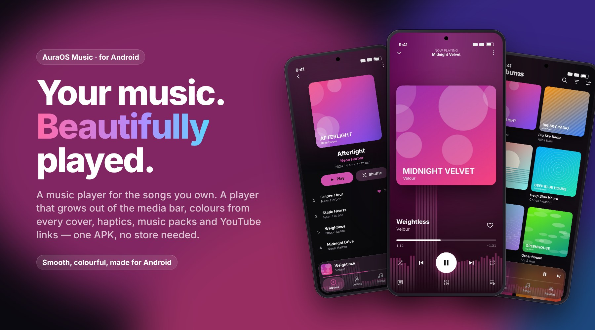
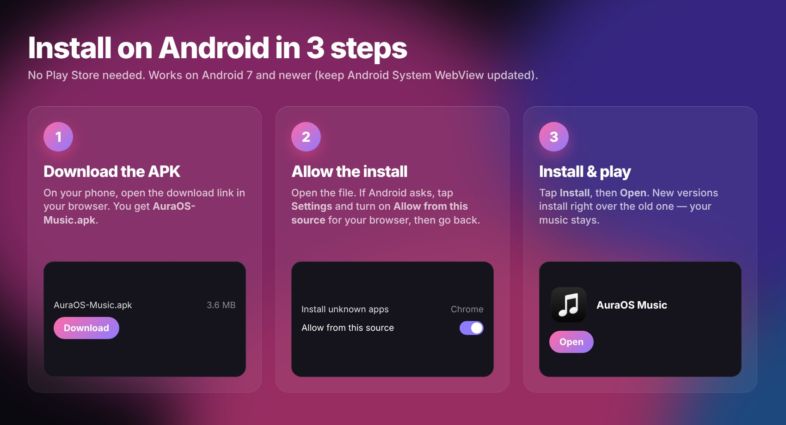
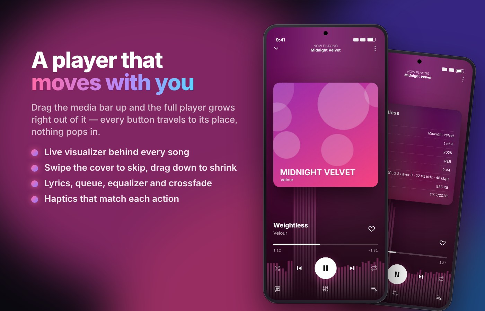
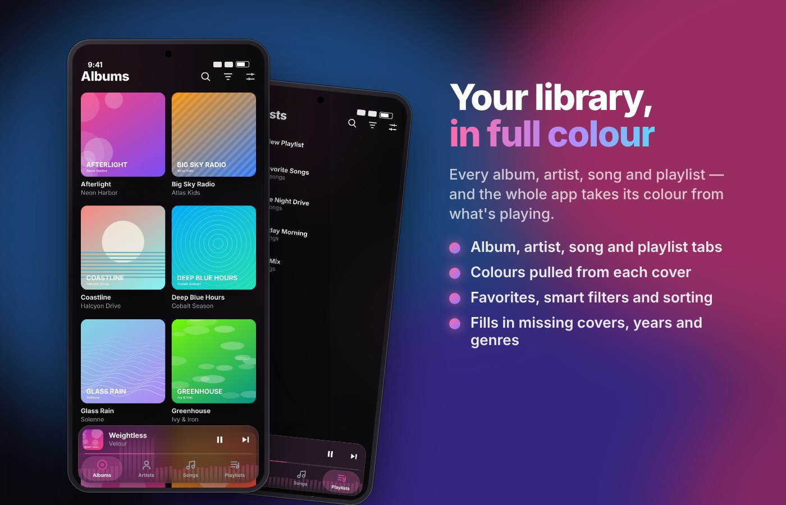
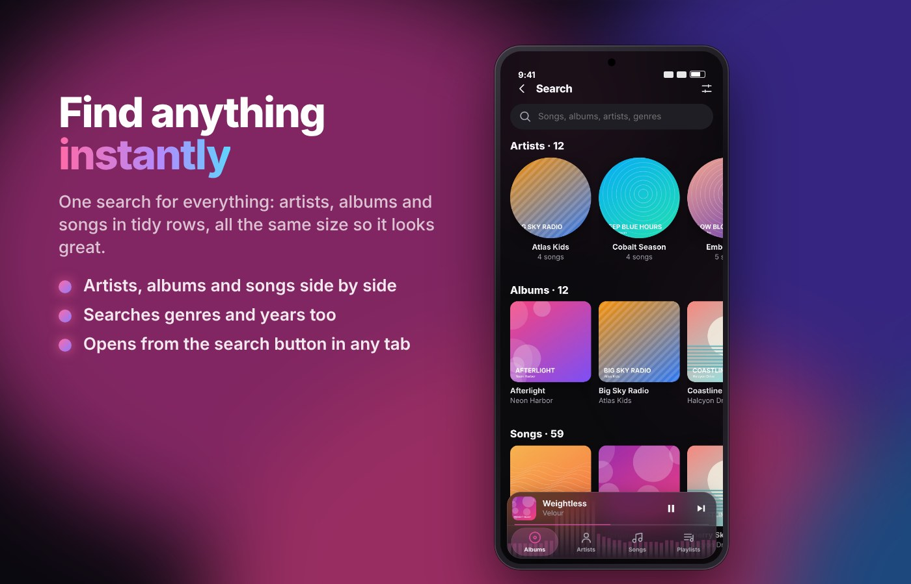
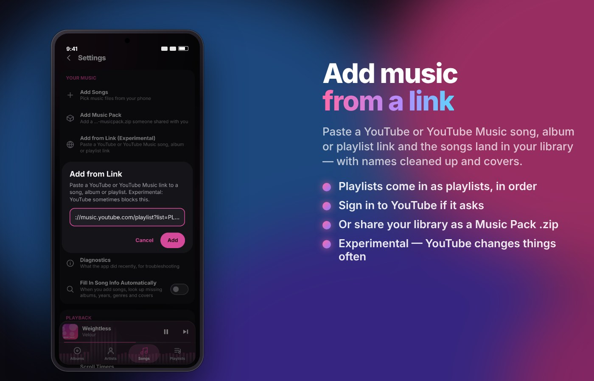
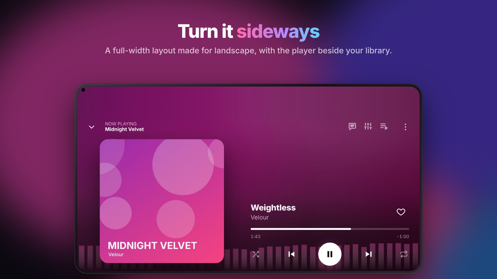

<div align="center">


# AuraOS Music for Android

**A music player for the songs you own: colourful, smooth, and full of little touches.**

[**⬇ Download the APK**](https://github.com/100kbrazy-a11y/auraos-music-android/releases/latest/download/AuraOS-Music.apk)
&nbsp;·&nbsp; [How to install](#install-in-3-steps)
&nbsp;·&nbsp; [Features](#features)
&nbsp;·&nbsp; [iPhone version](https://github.com/100kbrazy-a11y/auraos-music-ios)



</div>

## Install in 3 steps



1. **Download.** On your Android phone, open
   **[AuraOS-Music.apk](https://github.com/100kbrazy-a11y/auraos-music-android/releases/latest/download/AuraOS-Music.apk)**
   in Chrome (or any browser). If the browser warns that the file might be harmful, tap **Download anyway**.
2. **Allow the install.** Open the downloaded file. The first time, Android says installing unknown apps isn't
   allowed: tap **Settings**, turn on **Allow from this source** for your browser, then go back.
3. **Install and play.** Tap **Install**, then **Open**. Add music from **Settings › Add Songs**, a music pack, or a link.

**Updating:** download the same link again and install it. Every build is signed with the same key, so it
installs right over the old one and **your music and playlists stay**.

> If you had AuraOS Music on this phone from an older build made on your own computer, Android refuses to
> install over it ("App not installed" / "conflicts with an existing package"). Uninstall the old one first.
> That removes the music inside it, so make a **Music Pack** of your library beforehand and add it back after.

Works on Android 7 and newer. Keep **Android System WebView** up to date (Play Store) for the best looks.

## Features



- **The player grows out of the media bar.** Drag the bar up, or drag the cover down, and the player stretches
  with your finger. Every button glides to its place, and anything that has no partner fades, so nothing pops in.
- **Live visualizer** behind every song and a glow that pulses with the bass.
- **Swipe the cover** to skip or go back. **Tap it** to flip it over for the song's details, which you can scroll.
- **Lyrics** (synced, from LRCLIB), queue, 10-band **equalizer** with presets, and **crossfade** up to 12 seconds.
- **Haptics** that fit each action: taps, swipes, the seek bar, favouriting, closing the player.



- **Albums, Artists, Songs and Playlists.** Swipe sideways anywhere to switch tabs. **Favorite Songs** comes first.
- **Colours from every cover.** The whole app takes on the colour of what's playing, consistently everywhere.
- **Filters** by genre, artist, decade, length, favorites and recently added; sorting; multi-select.
- **Fills in the gaps:** missing covers, albums, years and genres are looked up online (you can turn this off).
- If a cover didn't save during a big import, the app repairs it from the song file by itself.



- **Search** from the button in any tab. Artists, albums and songs appear in tidy rows of same-size cards, with
  genres and years searched too.
- **Mixes:** play a song you searched for and similar songs from your library follow it.



- **Add from Link (experimental):** paste a YouTube or YouTube Music link to a song, album or playlist. The
  songs are downloaded with tidy names and covers, and a playlist link becomes a playlist in the same order.
  Sign in under **Settings › YouTube Account** if YouTube asks. YouTube changes its protections often, so this
  can stop working. If it fails, **Settings › Diagnostics › Share** shows why. Only add music you have the
  right to.
- **Add an artist from YouTube Music (experimental):** paste a `music.youtube.com/channel/UC…` artist link (or use
  **Artists › Add an artist from YouTube Music**). The app reads the artist's page, saves their photo and bio, and
  downloads their albums, singles & EPs (or just the top songs) album by album with covers, years and track numbers.
  Songs you already have are skipped, and a **Stop** button ends it early (what's done stays).
- **YouTube Music style artist page:** full-width artist photo with the name over it, **Shuffle** and **Radio**
  buttons, the songs (first five, then *Show all*), **Albums**, **Singles & EPs**, **Featured on**,
  **Fans might also like** and **About**. The globe button gets more from the same artist.
- **Music Packs:** share any songs, albums or playlists as a `…-musicpack.zip` and add packs from friends with
  all their info, covers and playlists. Packs also work with the iPhone and desktop apps.



- **Landscape layout:** the tabs become a floating pill, and the media bar can tuck itself into a cover
  while you scroll.
- **Edge to edge:** album colours run behind the status bar and navigation bar.
- **Background playback** with lock-screen and notification controls.

## Build it yourself

**On GitHub (no computer setup):** every push to `main` builds and signs the APK with GitHub Actions
(`.github/workflows/android.yml`) and publishes it to the
[latest release](https://github.com/100kbrazy-a11y/auraos-music-android/releases/latest). You can also run it by
hand: **Actions › Build Android app › Run workflow**.

**On a Linux computer (Fedora, Ubuntu…):**

```bash
git clone https://github.com/100kbrazy-a11y/auraos-music-android
cd auraos-music-android
./build-android.sh            # saves AuraOS-Music.apk in your Downloads folder
./build-android.sh --install  # also installs it on a phone plugged in by USB (USB debugging on)
./build-android.sh --clean    # rebuild the Android project from scratch
```

The script installs everything it needs (Node.js 22, Java 17, the Android SDK and Gradle). The first run
downloads about 1–2 GB. If it stops with `UnknownHostException`, your computer couldn't reach the internet or
DNS; run it again, or try `export JAVA_TOOL_OPTIONS="-Djava.net.preferIPv4Stack=true"` first.

**Signing:** both ways sign with `signing/release.jks`, so APKs from GitHub and from your computer update each
other. This repo is public, so anyone can see that key. That's fine for a personal app; for more privacy, move
it into GitHub secrets.

## For developers

- `npm run dev` runs the app in a browser, and `npm run build` builds the web part into `dist/`.
- The app is shared with the [iPhone version](https://github.com/100kbrazy-a11y/auraos-music-ios). Android leaves
  out the iPhone's native Liquid Glass and uses haptics through `@capacitor/haptics`.
- `android/` is the Capacitor 6 project, and `scripts/patch-android.mjs` sets its permissions, theme and
  `MainActivity`.
- `AuraPoPlugin.java` runs YouTube's player check in a hidden page that counts as www.youtube.com, for Add from Link.

<sub>The screenshots use a demo library of made-up artists with generated artwork.</sub>
